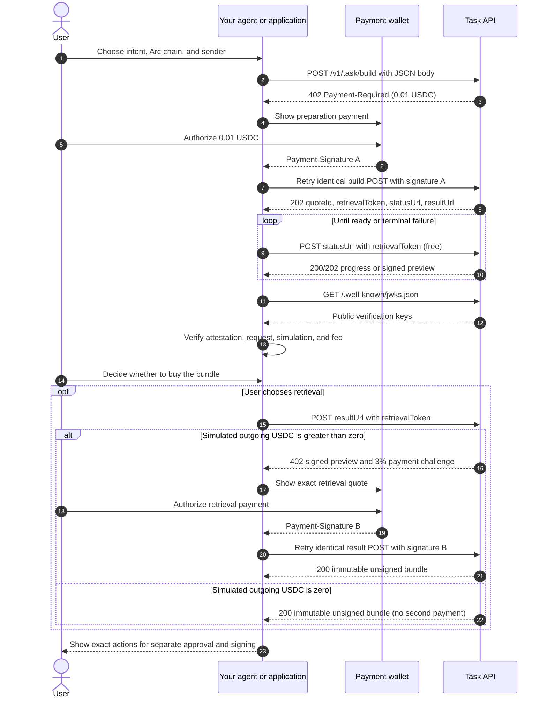

The Task API gives an agent or application a paid way to turn an onchain intent into a simulated, unsigned transaction bundle. You decide whether to buy the bundle after you inspect the preparation result. Your wallet keeps signing authority; the Task API does not sign or broadcast transactions.

Task API is a separate HTTP surface at `https://api.aomi.dev` for production and `https://api-staging.aomi.dev` for staging. Arc Mainnet uses `chainId: 5042`; Arc Testnet uses `chainId: 5042002`. Check [production](https://api.aomi.dev/v1/task/build) or [staging](https://api-staging.aomi.dev/v1/task/build) payment metadata to see which network the chosen host currently accepts. Task API uses x402 payments instead of the bearer token used by the [Agent and Pipeline APIs](/api-reference/overview).

## Request and payment sequence



The preparation and retrieval signatures authorize separate purchases. Neither signature authorizes the prepared transaction. If preparation fails, there is no bundle to buy.

## Pricing

| Stage | What you get | Price |
| --- | --- | --- |
| Preparation | A job and, when ready, a signed simulation summary with a retrieval price | 0.01 USDC for each new attempt (`10,000` micro-USDC) |
| Status checks | Progress or the signed preview | Free |
| Retrieval | The immutable unsigned transaction bundle | 3% of simulated gross outgoing USDC, quoted after preparation; free when that outflow is zero |

Preparation is charged per attempt and is non-refundable, including when an attempt fails to produce a usable bundle. The 3% fee is based on **gross outgoing USDC in the simulation**, not on the value of incoming assets or the number of calls. Read the signed preview's `pricing.fee_microusd` and the second `Payment-Required` challenge for the exact retrieval amount before paying.

| Simulated gross outgoing USDC | Preparation | Illustrative retrieval | Illustrative Task API total |
| ---: | ---: | ---: | ---: |
| 0 USDC | 0.01 USDC | 0 USDC | 0.01 USDC |
| 10 USDC | 0.01 USDC | 0.30 USDC | 0.31 USDC |
| 100 USDC | 0.01 USDC | 3.00 USDC | 3.01 USDC |

These examples assume one preparation attempt. A new attempt adds another 0.01 USDC. The preview also reports `pricing.outgoing_usdc_wei` (18-decimal USDC base units) and `pricing.preparation_fee_microusd`. Use the quoted fee for payment rather than calculating it from this table. The Task API does not sign or broadcast the bundle, so any later transaction execution is outside these Task API charges.

After a successful retrieval, the API supports repeat retrieval of the same frozen bundle for 30 days. Keep the `retrievalToken` private so only your application can access it.

## 1. Request preparation

Send an intent, Arc chain ID, and sender address to `POST /v1/task/build`. A valid unpaid request returns HTTP `402` with a `Payment-Required` challenge. Have your x402 client authorize the quoted 0.01 USDC payment, then repeat the **same method, URL, and JSON body** with its `Payment-Signature` header. Read the current challenge instead of hard-coding payment details.

```bash
curl -i https://api.aomi.dev/v1/task/build \
  -H 'Content-Type: application/json' \
  --data '{
    "intent": "Simulate a no-op on Arc Mainnet. Do not sign or broadcast any transaction.",
    "chainId": 5042,
    "sender": "0x000000000000000000000000000000000000dEaD"
  }'
```

This no-op example comes from the live API schema and reaches the payment challenge without charging you. For a real task, use your Arc wallet address and your intended action. The paid retry returns HTTP `202` with a `quoteId`, a private `retrievalToken`, and URLs for status and result. Store the token as a secret.

## 2. Inspect the result for free

Poll the returned status URL with `POST` and a JSON body containing your `retrievalToken`. Honor `retryAfter` when the job is still preparing. Status checks do not require another payment.

When status is `ready`, verify the signed preview against the public [Task signing keys](https://api.aomi.dev/.well-known/jwks.json). Check the request hash, interpreted actions, safety findings, simulated effects, and retrieval price against the intent you meant to submit. Do not treat a `ready` status or an x402 payment as approval to sign.

## 3. Choose whether to retrieve

If you want the bundle, `POST` the same token to the returned result URL. When a retrieval fee applies, the API returns a second HTTP `402` challenge that includes the preview. Verify it, authorize the 3% fee, and repeat the **same request body** with a new `Payment-Signature`. A zero-outflow result needs no second payment.

The result is an immutable, unsigned bundle. Show its exact actions to the user and pass it through your application's own policy, approval, and wallet-signing flow before any broadcast. The Task API has no `TaskAuthorization` step and does not execute the bundle.

<Warning>
  Keep separate payment records for preparation and retrieval. If a payment response is uncertain, recover its outcome before creating a new payment; a new authorization may charge you again.
</Warning>

See the [Task API reference](/api-reference/task) for request fields, responses, and the live OpenAPI contract.
